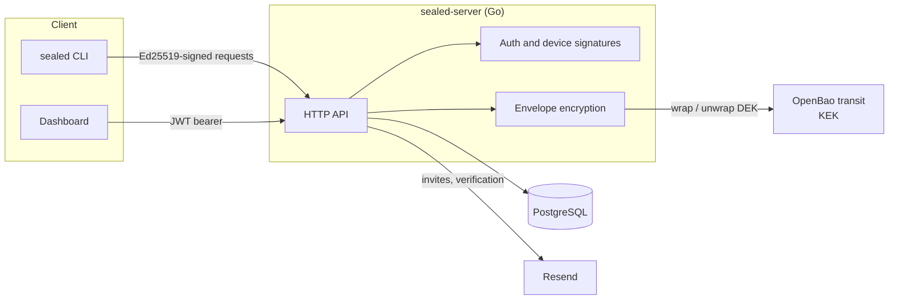
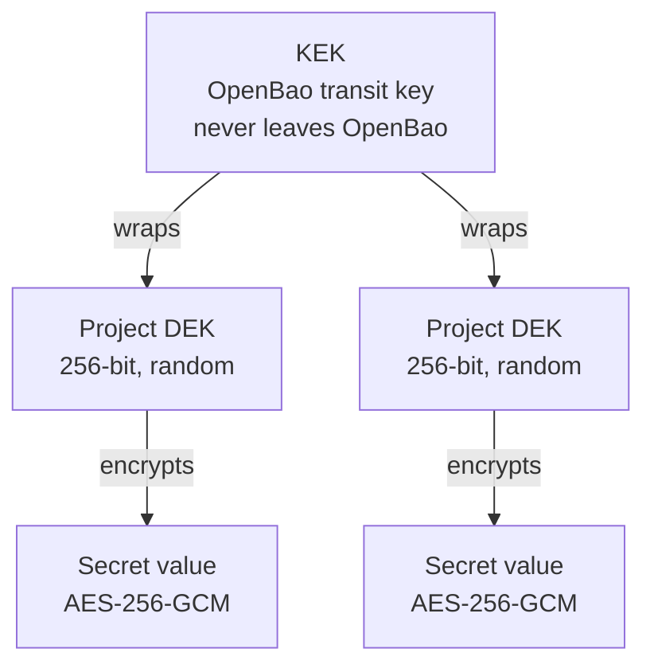
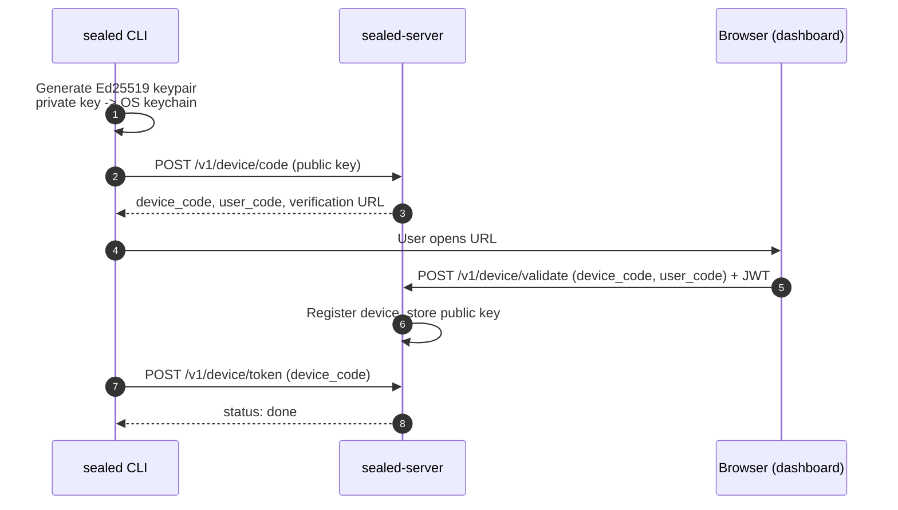
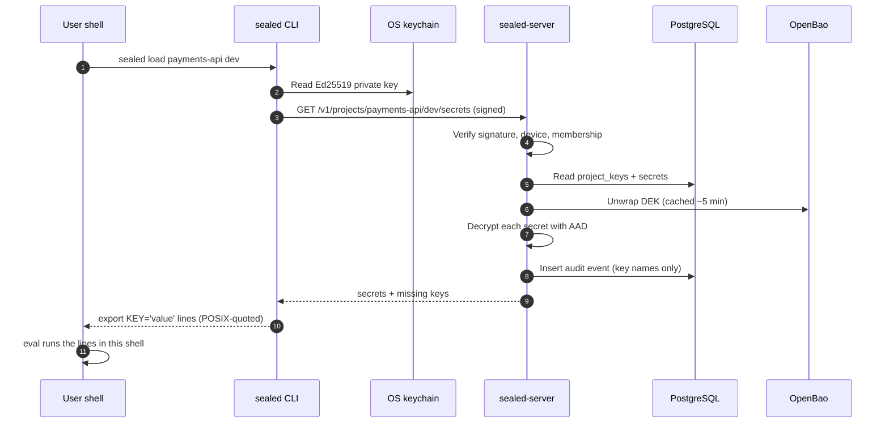
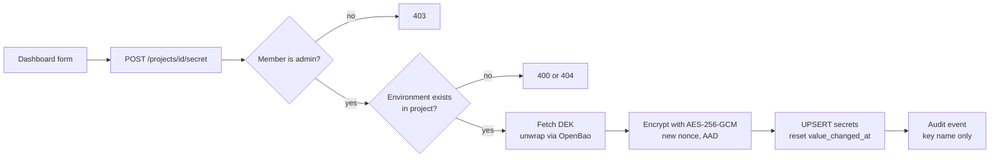
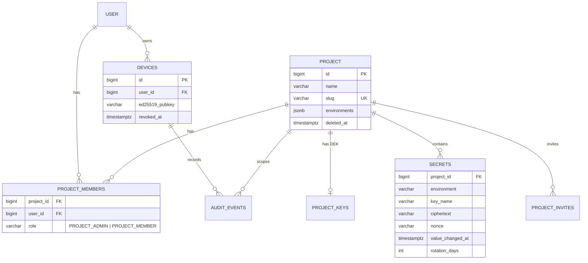
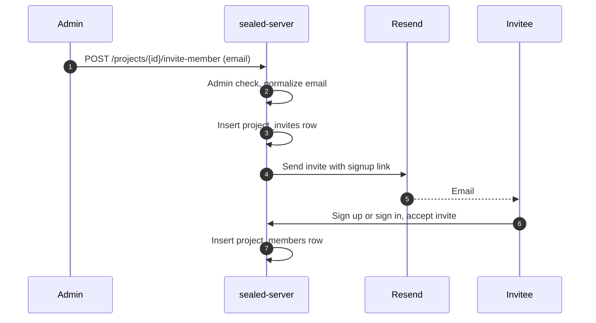

# Sealed

Sealed keeps your project's environment variables out of dotfiles, chat threads, and CI settings pages. Load them into your terminal with one command, run a process with them injected, and cut off a lost laptop in one step.

---

## Part I: Overview

### What it does

Sealed stores secrets per project and per environment (`dev`, `staging`, `prod`). Collaborators on a project share the same secrets without copying them around by hand.

- **Load into your shell:** `eval "$(sealed load payments-api dev)"` sets the variables in the terminal you're already using.
- **Run with secrets:** `sealed run payments-api dev -- npm start` starts a process with the secrets in its environment and never prints them.
- **Per-device access:** each machine signs its own requests with an Ed25519 key stored in the OS keychain. There are no bearer tokens to steal.
- **Revoke instantly:** revoking a device cuts its access on the next request.
- **Rotation reminders:** each secret can have a rotation interval, and the dashboard shows what's due.

### Who it's for

Individual developers working with a small group of collaborators on a project. Teams and organizations are not supported in v1.

### Components

| Component | Folder | Purpose |
|---|---|---|
| CLI | `sealed-cli/` | Login, load, and run secrets from the terminal |
| API server | `sealed-server/` | Authentication, secret storage, access control, audit |
| Dashboard | `sealed-dashboard/` | Manage projects, secrets, members, and devices in a browser |

### Quick start

```bash
# Install the CLI
brew install --cask souravlayek/tap/sealed

# Sign in this machine
sealed login

# Load a project's dev secrets into the current shell
eval "$(sealed load payments-api dev)"

# Or run a single command with them
sealed run payments-api dev -- npm start
```

Create projects, add secrets, and invite collaborators from the dashboard.

To build the CLI from source instead, you can run `go install github.com/souravlayek/sealed/sealed-cli/cmd/sealed@latest`.

### Running the stack locally

```bash
cp .env.example .env     # fill in real values, never commit .env
docker compose up -d --build
```

- Dashboard: http://localhost:3000
- API: http://localhost:8080/api

---

## Part II: Technical Deep Dive

### Architecture



Three rules shape the design:

1. Plaintext secrets exist only in the server's memory during a request, and in the CLI's memory during a command.
2. The database alone is useless. Ciphertexts need per-project DEKs, and those DEKs are wrapped by a KEK that never leaves OpenBao.
3. Every request from the CLI is signed by a key that stays in the OS keychain.

### Key hierarchy (envelope encryption)



- Each project gets its own DEK, stored in `project_keys` wrapped by the KEK.
- Each secret write uses a fresh 96-bit nonce.
- The AAD for each secret is `project_id | environment | key_name`, so a ciphertext copied to another row fails to decrypt.
- KEK rotation rewraps the DEKs and leaves ciphertexts untouched. The AAD excludes the KEK version for that reason.

### Device authentication

Each CLI machine registers once through the device flow (RFC 8628), then signs every request.



Each signed request covers this canonical string:

```
METHOD \n
PATH_WITH_QUERY \n
TIMESTAMP \n
NONCE \n
SHA256_HEX(BODY)
```

The server checks, in order:

1. The timestamp is within about 60 seconds of server time, in either direction.
2. The nonce hasn't been seen before (stored with a TTL).
3. The device exists and `revoked_at` is null.
4. The Ed25519 signature verifies against the device's public key.
5. The caller is an active member of the project for project routes.

Dashboard sessions use JWT access tokens (5-minute expiry) and refresh tokens. The browser never signs requests.

### Load and run paths



Design points for the load path:

- **All or nothing:** any decryption or integrity failure aborts the whole response. Partial plaintext is never returned.
- **Missing keys:** the server computes keys defined in the project but absent in the requested environment. The CLI exits with code 3 unless `--allow-missing` is set.
- **`run` never prints:** `sealed run` injects the variables into the child process's environment and does not write them to stdout.
- **Why `eval`:** a child process can't modify its parent shell's environment, so `load` prints commands and the shell runs them.

### Secret write path



An upsert on `(project_id, environment, key_name)` updates an existing secret in place and resets its rotation clock.

### Data model



Soft deletes (`deleted_at`) apply to projects, members, and devices. Every query that reads them filters `deleted_at IS NULL`.

### Invites



Invites don't grant access until accepted. Admins can see and revoke pending invites.

### Failure modes

| Failure | Behavior |
|---|---|
| Decryption or integrity check fails on load | Whole response aborts with 500. No partial values. |
| OpenBao unreachable | Reads that need a DEK fail. Cached DEKs serve briefly. |
| Device revoked | Next signed request fails. Values already on the machine remain, so rotate them at the provider. |
| Signature or timestamp invalid | Rejected before any database access. |
| Missing keys in environment | Exit code 3, or 0 with `--allow-missing`. |

### Security model

| Threat | Mitigation |
|---|---|
| Database leak | Ciphertexts and wrapped DEKs are useless without the KEK in OpenBao |
| Stolen laptop | Revoke the device; the private key is in the OS keychain |
| API server compromise | Plaintext exists only in memory during requests; audit logs record activity |
| Replayed requests | Timestamp window plus nonce store |
| Removed collaborator | Access stops immediately; rotate values they already loaded |

### Repository layout

```
sealed/
├── sealed-cli/         Go module, CLI entry point in cmd/sealed
├── sealed-server/      Go module, API server (sqlc, swagger)
├── sealed-dashboard/   React + Vite + shadcn/ui
├── docker-compose.yml
└── .env.example
```

### Development

- **Server:** `cd sealed-server && go run ./cmd/server`. Regenerate queries with `sqlc generate` and docs with `swag init`.
- **CLI:** `cd sealed-cli && go run ./cmd/sealed`. Release with GoReleaser from a `sealed-cli/v*` tag.
- **Dashboard:** `cd sealed-dashboard && npm install && npm run dev`.

---

## License

TBD
